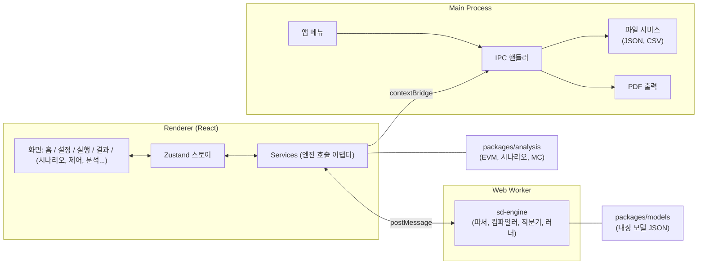
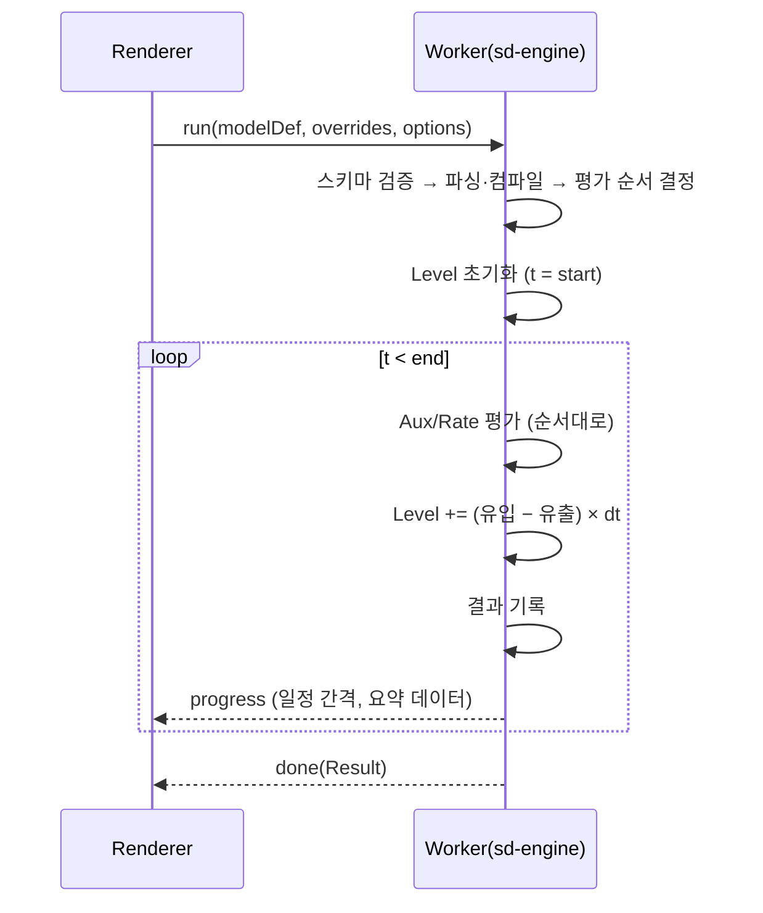

# 아키텍처 설계

기능 목록([02.기능목록.md](../01.분석/02.기능목록.md))과 기술 스택([01.기술스택.md](01.기술스택.md))을 바탕으로 한 구조 설계. MVP를 상세히 정의하고, 2~4차 기능이 들어갈 자리를 함께 표시한다.

## 1. 설계 원칙

1. **엔진 분리**: 시뮬레이션 엔진은 UI·Electron과 무관한 순수 TypeScript 패키지. 테스트, Worker, Monte Carlo 병렬화에 그대로 쓴다.
2. **모델은 데이터**: 모델·시나리오·프로젝트는 모두 JSON. 코드 변경 없이 모델과 파라미터를 바꾼다.
3. **재현성**: 같은 모델 + 같은 파라미터 + 같은 시드 = 같은 결과.
4. **프로세스 경계에서 최소 권한**: renderer는 파일·OS에 접근하지 않고 main이 IPC로 중개한다.
5. **점진 확장**: 단계(MVP→4차)별로 모듈이 추가되며 기존 모듈 인터페이스는 유지한다.

## 2. 전체 구조



- Renderer ↔ Worker: 실행 요청과 진행/결과 메시지.
- Renderer ↔ Main: preload가 노출한 IPC만 사용(파일 열기/저장, CSV, PDF, 메뉴 이벤트).
- `analysis` 패키지의 순수 계산(EVM, 비교 지표, 통계)은 renderer에서 호출하고, 무거운 반복 실행은 Worker 풀을 사용한다.

## 3. 모듈 설계

### 3.1 sd-engine (순수 TS)

| 모듈 | 책임 |
|---|---|
| `model/schema` | 모델 정의 타입과 zod 스키마 (Level, Rate, Auxiliary, Constant, Table) |
| `expr/tokenizer`, `expr/parser` | 수식 문자열 → AST |
| `expr/compiler` | AST → 실행 클로저, 의존성 추출 |
| `expr/functions` | 내장 함수 레지스트리 (IF, STEP, DELAY, SMOOTH, GRAPH, 난수 ...) |
| `model/graph` | 변수 의존 그래프, 평가 순서(위상 정렬), 순환 참조 감지 (SIM-07) |
| `solver/integrator` | 적분기 인터페이스. `EulerIntegrator`(MVP), `RK4Integrator`(후속) |
| `runner` | 초기화, 시간 루프, 결과 기록, 진행 콜백, 일시정지·스텝·리셋 (SIM-05) |
| `result` | 결과 컨테이너: 변수별 `Float64Array`, 메타(dt, 시작·종료, 시드) |
| `rng` | 시드 PRNG와 분포 샘플러 |

**실행 흐름**



**주요 인터페이스(개념)**

```ts
interface ModelDef {
  meta: { id: string; name: string; version: number; timeUnit: 'day' };
  time: { start: number; end: number; dt: number };
  constants: Record<string, { value: number; unit?: string; label?: string }>;
  levels: Record<string, { init: string; inflows: string[]; outflows: string[]; unit?: string }>;
  rates: Record<string, { expr: string; unit?: string }>;
  auxiliaries: Record<string, { expr: string; unit?: string }>;
  tables: Record<string, { x: number[]; y: number[] }>;
  outputs: string[]; // 기본 표시 변수
}

interface RunOptions {
  overrides?: Record<string, number>; // 파라미터 덮어쓰기 (시나리오)
  seed?: number;
  dt?: number;
  recordEvery?: number;
}

interface RunResult {
  time: Float64Array;
  series: Record<string, Float64Array>;
  meta: { seed: number; dt: number; model: string; version: number };
}
```

### 3.2 models (내장 모델 JSON)

| 모델 | 단계 | 내용 |
|---|---|---|
| `brooks.json` | MVP | 책 1.4 Brooks 법칙 모델. 인력 추가 시점·인원을 파라미터로 노출 |
| `integrated-project.json` | MVP | 핵심 4섹터 단순판(인력·계획·생산·통제). 섹터별 변수 접두어 `hr_`, `plan_`, `prod_`, `ctl_` |
| `structures/*.json` | MVP(중) | 3장 기본 구조 (생산·재작업, 학습곡선, Rayleigh 등) |

각 모델은 UI가 입력 폼을 만들 수 있도록 **파라미터 메타**(라벨, 단위, 허용 범위, 기본값, 그룹)를 포함한다. 프로젝트 설정 화면(CFG)은 이 메타로 동적 생성된다.

**CFG 입력 → 모델 파라미터 매핑**
프로젝트 설정(규모·목표·조직 특성)은 `mapping` 규칙을 통해 모델의 상수 값 덮어쓰기로 변환된다. 예: `규모(태스크)` → `total_tasks`, `신입 비율` → `initial_rookies`. 매핑은 모델 파일에 함께 정의한다.

### 3.3 analysis (2차 이후)

| 모듈 | 단계 | 책임 |
|---|---|---|
| `evm` | 2차 | PV/EV/AC, CPI, SPI, 편차, EAC/ETC 계산 (CTL-03, CTL-06) |
| `scenario` | 2차 | 시나리오 정의(덮어쓰기), 일괄 실행, 비교 지표 추출 |
| `reforecast` | 2차 | 실적으로 모델 상태 보정 후 현재 시점부터 재실행 (CTL-07) |
| `montecarlo` | 3차 | 분포 샘플링, N회 반복, 분위수·신뢰구간·달성 확률 |
| `sensitivity` | 3차 | 파라미터 스윕, 토네이도 지표 |
| `validation` | 3차 | MAPE, RMSE, 극단 조건 테스트 |

### 3.4 desktop 앱

**Main 프로세스**

| 모듈 | 책임 |
|---|---|
| `app/window` | 창 생성, 보안 옵션(contextIsolation 등) |
| `app/menu` | 앱 메뉴(COM-01)와 메뉴 → renderer 이벤트 |
| `ipc/project` | 프로젝트 열기·저장·최근 목록·자동 저장 |
| `ipc/files` | CSV 가져오기/내보내기, 이미지 저장 |
| `ipc/report` | HTML 템플릿 → PDF (4차) |
| `store/recent` | 최근 프로젝트 목록 저장 |

**Preload**: `window.spd` API만 노출한다.

```ts
window.spd = {
  project: { open(), save(project), saveAs(project), recent() },
  files:   { importCsv(), exportCsv(name, data), exportImage(name, dataUrl) },
  menu:    { on(event, handler) },
  report:  { exportPdf(html) } // 4차
}
```

**Renderer**

| 영역 | 구성 |
|---|---|
| 라우팅 | 홈, 프로젝트 설정, 실행, 결과 (MVP). 시나리오, 제어, 분석, 검증, 에디터, 보고서는 후속 |
| 스토어 | `projectStore`(현재 프로젝트·설정), `runStore`(실행 상태·진행·결과), `uiStore` |
| 서비스 | `engineClient`(Worker 래퍼), `projectService`(IPC 래퍼), `modelCatalog`(내장 모델 목록) |
| 컴포넌트 | `ParamForm`(메타 기반 동적 폼), `TimeSeriesChart`, `DataTable`, `RunControls`, `SummaryCards` |

## 4. 저장소·폴더 구조

```
SPD/
├─ packages/
│  ├─ sd-engine/
│  │  └─ src/{model,expr,solver,runner,rng,result}/
│  ├─ models/
│  │  └─ src/{brooks.json, integrated-project.json, structures/}
│  └─ analysis/
│     └─ src/{evm,scenario,reforecast,montecarlo,sensitivity,validation}/
├─ apps/desktop/
│  └─ src/
│     ├─ main/{app,ipc,store}/
│     ├─ preload/
│     └─ renderer/{pages,components,stores,services,i18n}/
├─ docs/
├─ package.json            # npm workspaces
└─ tsconfig.base.json
```

## 5. 데이터 설계

### 5.1 프로젝트 파일 (`*.spd.json`)

```jsonc
{
  "schemaVersion": 1,
  "meta": { "name": "...", "description": "...", "createdAt": "...", "updatedAt": "..." },
  "model": { "id": "integrated-project", "version": 1 },
  "settings": {                       // CFG-01~03 입력
    "size":    { "tasks": 400 },
    "targets": { "durationDays": 180, "budget": 0, "maxStaff": 20 },
    "process": { "inspection": false, "reuseRatio": 0, "requirementsVolatility": 0.1 },
    "org":     { "rookieRatio": 0.5, "turnoverRate": 0.02, "hiringDelayDays": 20, "overtimeLimit": 0.2 }
  },
  "run": { "dt": 0.25, "end": 400, "seed": 12345 },
  "scenarios": [],                    // 2차: { id, name, overrides, baseline? }
  "actuals": [],                      // 2차: 주간 실적
  "results": { "lastRun": null }      // 선택 저장: 요약 지표, 필요 시 시계열 파일 분리
}
```

- `schemaVersion`으로 마이그레이션한다. zod 스키마로 로드 시 검증하며 실패하면 오류 위치를 표시한다.
- 시계열 전체는 프로젝트 파일에 넣지 않고 **요약 지표만 저장**하여 파일 크기를 억제한다. 필요하면 재실행한다(재현성 보장). 대용량 저장이 필요하면 후속에 `*.results.bin` 분리를 검토한다.

### 5.2 내장 예제 보호 (NFR-07)

내장 모델·예제는 앱 리소스에서만 읽고, "예제 열기"는 항상 복사본 프로젝트로 연다.

## 6. 주요 화면 ↔ 모듈 매핑 (MVP)

| 화면 | 사용하는 모듈 | 기능 ID |
|---|---|---|
| 홈 | `projectService`, `modelCatalog` | PRJ-01~04 |
| 프로젝트 설정 | `ParamForm`, 모델 파라미터 메타·매핑, zod 검증 | CFG-01~05 |
| 실행 | `engineClient`, `RunControls`, 실시간 `TimeSeriesChart` | SIM-05, RUN-01~03 |
| 결과 | `TimeSeriesChart`, `DataTable`, `files.exportCsv/Image` | RES-01~05 |
| Brooks 예제 | brooks 모델 + 실행 결과 복수 겹쳐 보기 | MDL-01, SC-02 |

## 7. 비기능 요구 대응

| 요구 | 설계 대응 |
|---|---|
| NFR-01 성능 | 컴파일된 클로저 평가, 변수 인덱스 배열 접근, 결과는 `Float64Array`. 400일 / dt 0.25 = 1,600 스텝 규모는 수 ms~수십 ms 목표 |
| NFR-02 응답성 | 시뮬레이션은 Worker. 진행 메시지는 스로틀링 |
| NFR-03 오프라인 | 외부 요청 없음. 폰트·리소스를 앱에 포함 |
| NFR-04 데이터 | JSON, `schemaVersion` |
| NFR-05 재현성 | 시드를 프로젝트에 저장, 실행 메타에 기록 |
| NFR-06 플랫폼 | OS 의존 코드를 main에 한정, 경로 처리를 Node `path`로 통일 |
| NFR-07 예제 보호 | 5.2 참조 |

## 8. 테스트 전략

| 층 | 내용 |
|---|---|
| 엔진 단위 테스트 | 파서·함수, 해석해가 있는 모델: 지수 성장, 목표 추구, 지연(DELAY1/3), 보존(질량 보존) |
| 모델 회귀 테스트 | Brooks 모델의 인력 추가 시점별 완료일 경향, 통합 모델의 스냅샷(허용 오차 포함) |
| 스키마 테스트 | 모델·프로젝트 JSON 유효/무효 케이스 |
| 컴포넌트 테스트 | `ParamForm` 검증, 차트 데이터 변환 |
| E2E (Playwright) | 새 프로젝트 → 설정 → 실행 → 결과 → CSV 내보내기 |

## 9. 구현 순서 제안 (MVP)

| 순서 | 작업 | 완료 기준 |
|---|---|---|
| 1 | 저장소·workspaces·빌드 설정, Electron 빈 창 | `npm run dev`로 창 표시, 타입·린트 통과 |
| 2 | sd-engine: 파서/컴파일러/적분기/러너 | 단위 테스트(해석해 대조) 통과 |
| 3 | Brooks 모델 JSON + CLI 실행 스크립트 | 책 그래프와 형태 일치 확인 |
| 4 | 렌더러: 실행·결과 화면(Brooks 먼저) | SC-02 흐름 동작 |
| 5 | 프로젝트 저장·열기, 설정 화면, 파라미터 메타 | SC-01 일부(저장·재열기) |
| 6 | 통합 프로젝트 모델(4섹터 단순판) | SC-01 전체 동작 |
| 7 | 결과 내보내기(CSV/PNG), 기준 행동 비교, E2E | SC-03 완료, MVP 종료 |

## 10. 열린 이슈

1. 통합 프로젝트 모델 단순판의 변수·수식 확정은 책 6.3을 읽고 별도 문서(모델 명세)로 정리한 뒤 구현한다.
2. 4차 모델 에디터의 JSON 모델과 다이어그램 좌표(레이아웃) 저장 형식은 4차에 확정한다.
3. Windows 빌드와 서명·공증 절차는 MVP 이후 결정한다.
4. 다국어(한/영)는 MVP에서는 한국어만 제공하고 문자열 분리만 해 둔다.
