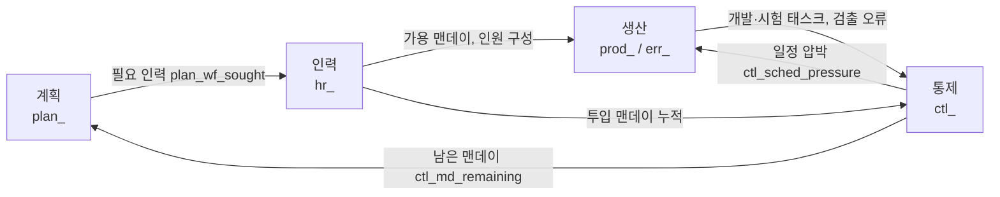

# 통합 프로젝트 모델 명세 (4섹터 단순판)

MVP 모델 `integrated-project.json`(MDL-02)의 변수·수식·파라미터 명세. 수식 문법과 함수는 [01.기술스택.md](01.기술스택.md) 2.3절, 모델 JSON 구조는 [02.아키텍처설계.md](02.아키텍처설계.md) 3.1절을 따른다.

## 0. 먼저 읽을 것: 이 명세의 신뢰 수준

책(6.3, 4.3~4.4)은 Abdel-Hamid 모델의 **구조와 일부 수치**만 서술한다. 전체 방정식과 그래프 함수 값은 책 구매자용 `.itm` 모델에 있고 `docs/ref`에는 없다. 그래서 이 명세는 책을 그대로 옮긴 것이 아니라 **책의 구조를 따라 새로 설계한 단순판**이다. 값마다 출처를 표시한다.

| 표시 | 의미 |
|---|---|
| **[책]** | 책 본문에 값 또는 수식이 명시됨 (쪽수 병기) |
| **[책-그림]** | 책의 곡선 그림에서 좌표를 읽어 옮김(그림 번호 병기). 눈금 해석 오차가 있어 ±0.03 정도로 본다 |
| **[책-해석]** | 책의 서술을 바탕으로 정의했으나 해석이 들어감. 구현 전 확인 필요 |
| **[설계]** | 책에 구조만 있고 수식·곡선 모양은 이 문서에서 정한 것. 보정 대상 |
| **[가정]** | 책 본문에 값이 없어 임의로 둔 초기값. 보정 대상 |

따라서 **통합 모델의 수치 결과는 책 그림과 정량적으로 일치하지 않는다.** 검증 기준은 정성적 거동(6장)이다. 반면 Brooks 모델은 책에 수치가 충분해 정량 검증이 가능하다(6.1).

책에서 확인한 수치(근거):

| 항목 | 값 | 위치 |
|---|---|---|
| 태스크 크기 | 60 라인(약 0.06 KDSI) | 6.3, p.374 |
| 숙련자/신입 잠재 생산성 | 1 / 0.5 태스크/맨데이 | 6.3.1.3.2.1, p.380 |
| 학습 곡선 배수 | S자, 1 → 1.25 | p.380 |
| 프로젝트 투입 기준 비율 | 0.6 (나머지 40%는 비업무) | p.380, 4.4 |
| QA 인력 비율 기본 | 15% | p.378 |
| 오류 발생 | 25 → 12.5 오류/KDSI (설계 시작 → 코딩 종료) | p.382 |
| 신입의 오류 발생 | 숙련자의 2배 | p.382 |
| QA 지연 | 10일 | p.382 |
| 오류 1건 검출 QA 노력 | 평균 2.4시간 | p.382 |
| 설계 오류 | 코딩 오류 대비 수정 비용 1.6배 | p.382 |
| 재작업 중 불량 수정 비율 | 0.075 | p.384 |
| 시험 계획 오버헤드 | 2 맨데이/KDSI | p.385 |
| 시험 노력 | 오류당 1.2 인시 | p.385 |
| 인원 추가 시 태스크 포함 지연 | 10일 | p.390 |
| 과소추정 파라미터 | 0.67 (기본 설정) | p.391 |
| 소진 회복 지연 / 최대 허용 소진 | 20일 / 50일 | 4.4, p.225 |
| 의사소통 오버헤드 | 0.06·n² (%) | 1.4, p.19 |
| 훈련 오버헤드 | 신입 1명당 숙련자 0.25 FTE (Brooks 모델) | p.19 |

## 1. 범위와 단순화

### 1.1 포함

| 섹터 | 접두어 | 내용 |
|---|---|---|
| 인력 | `hr_` | 신입/숙련 두 레벨, 채용·동화·퇴직·전출, 훈련 오버헤드 |
| 계획 | `plan_` | 일정 재계획, 필요 인력 결정(안정성 vs 일정 압박 가중) |
| 생산 | `prod_`, `err_` | 인력 배분, 개발·QA·시험 태스크 흐름, 오류 발생·검출·재작업, 생산성(학습·의사소통·동기·소진) |
| 통제 | `ctl_` | 인식된 작업량, 태스크 발견, 남은 맨데이, 일정 압박 |

### 1.2 제외(이후 단계로 이월)

| 제외 항목 | 책의 내용 | 대체 방식 |
|---|---|---|
| 능동/수동 오류 구분, 능동 오류 재생성 | 6.3.1.3.4 | 시험 단계는 "QA를 빠져나온 오류"를 단일 레벨로 처리 |
| 소진 상태의 이력 의존(소진이 모두 회복될 때까지 과로 재진입 금지) | 4.4 | 소진 수준에 따른 과로 허용 곡선으로 근사 |
| 신입 전출, 과로 기간 임계값(`overwork duration threshold`) 동적 변화 | 4.3, 4.4 | 소진 수준 곡선 하나로 통합 |
| 설계/코딩 오류 구분, 오류 종류별 곡선 | 6.3.1.3.3 | 단일 오류 유형 |
| 발견 태스크의 맨데이 환산 비율 곡선(1% 미만 무시) | p.391 | 발견 태스크를 전부 환산 |
| `Basic COCOMO` 초기 규모 추정 | p.386 | 계획 생산성 기반 추정(옵션으로 COCOMO 추가 예정) |
| 작업률 조정 상세(Work Rate Adj Time, 초과 맨데이 감당 한계) | Figure 6.9 | `SMOOTH`와 최대 증가율 상한 |

## 2. 섹터 간 정보 흐름



주요 피드백 루프:

1. **일정 압박 → 과로/QA 축소 → 오류 증가 → 재작업 증가 → 일정 압박**(생산·통제)
2. **인원 부족 → 채용(지연) → 훈련 오버헤드·의사소통 오버헤드 → 생산성 저하**(계획·인력·생산, Brooks 법칙)
3. **태스크 발견 → 인식 작업량 증가 → 일정 연장·인력 증원**(통제·계획·인력)
4. **과로 → 소진 → 과로 불가 → 생산성 저하**(생산)

## 3. 파라미터

단위: 시간 일, 규모 태스크, 노력 맨데이(man-day, md), 인원 명. "CFG"는 프로젝트 설정 화면 입력에서 변환되는 값이다.

### 3.1 프로젝트·조직(사용자 입력)

| 변수 | 기본값 | 단위 | 범위 | 출처 | 의미 |
|---|---|---|---|---|---|
| `total_tasks` | 400 | 태스크 | 20~5000 | [설계] | 실제 작업 규모. CFG: 규모·재사용 |
| `plan_known_fraction` | 0.67 | 비율 | 0.3~1 | [책-해석] | 계획 시점에 알려진 태스크 비율. 책의 "과소추정 0.67"을 이렇게 해석(p.391). 1이면 과소추정 없음 |
| `planned_duration_days` | 200 | 일 | 30~1000 | [설계] | 초기 계획 일정 |
| `max_tolerable_factor` | 1.5 | 배 | 1.1~3 | [가정] | 허용 한계 일정 = 계획 일정 × 이 값 |
| `max_staff` | 20 | 명 | 1~200 | [설계] | 인력 상한 |
| `initial_pros` | 4 | 명 | 0~200 | [설계] | 초기 숙련 인원 |
| `initial_new` | 0 | 명 | 0~200 | [설계] | 초기 신입 인원 |
| `planned_qa_fraction` | 0.15 | 비율 | 0.05~0.4 | [책] | 계획된 QA 인력 비율(p.378) |
| `plan_dev_prod` | 0.6 | 태스크/맨데이 | 0.1~2 | [설계] | 초기 계획에 쓰는 개발 생산성(숙련 1.0 × 투입 비율 0.6) |
| `plan_test_prod` | 3 | 태스크/맨데이 | 1~20 | [가정] | 초기 계획에 쓰는 시험 생산성. 6에서 3으로 낮췄다(구현 후 보정, 7장 참조) |
| `estimate_margin` | 1.0 | 배 | 0.5~2 | [설계] | 초기 맨데이 추정 여유 계수 |

### 3.2 인력

| 변수 | 기본값 | 단위 | 출처 | 의미 |
|---|---|---|---|---|
| `hiring_delay` | 40 | 일 | [가정] | 채용 지연(1차 지수 지연). CFG: `hiringDelayDays` |
| `assim_delay` | 80 | 일 | [가정] | 신입 → 숙련 동화 시간. Brooks 모델은 20일(p.19)이나 통합 모델은 더 길게 둠 |
| `avg_employment_time` | 673 | 일 | [가정] | 평균 재직 기간(퇴직률 = 1/이 값). CFG: `turnoverRate`로 환산 |
| `transfer_delay` | 10 | 일 | [가정] | 숙련자 전출 지연 |
| `trainers_per_hiree` | 0.25 | FTE | [책] | 신입 1명당 훈련에 쓰이는 숙련자 비율(p.19, Brooks 모델 값) |
| `max_hirees_per_fte` | 3 | 명/명 | [가정] | 숙련자 1명당 수용 가능한 신입 수 |

### 3.3 생산성·동기·소진

| 변수 | 기본값 | 단위 | 출처 | 의미 |
|---|---|---|---|---|
| `pro_prod` | 1.0 | 태스크/맨데이 | [책] | 숙련자 잠재 생산성 |
| `new_prod` | 0.5 | 태스크/맨데이 | [책] | 신입 잠재 생산성 |
| `frac_nominal` | 0.6 | 비율 | [책] | 압박이 없을 때 하루 중 프로젝트 업무 비율 |
| `max_boost` | 0.7 | 비율 | [가정] | 압박 시 업무 비율 최대 증가율(0.6 → 약 1.0). CFG: `overtimeLimit` |
| `max_slack` | 0.2 | 비율 | [가정] | 일정이 앞설 때 업무 비율 최대 감소율 |
| `work_rate_adj_time` | 10 | 일 | [가정] | 업무 비율이 목표에 접근하는 시간(`SMOOTH`) |
| `exh_max_tolerable` | 50 | 일 | [책] | 최대 허용 소진(p.225) |
| `exh_depletion_delay` | 20 | 일 | [책] | 소진 회복 지연(p.225) |
| `comm_coeff` | 0.0006 | 1/명² | [책] | 의사소통 오버헤드 = `comm_coeff × n²` (0.06·n² %, p.19). 상한 0.9 |

### 3.4 품질

| 변수 | 기본값 | 단위 | 출처 | 의미 |
|---|---|---|---|---|
| `qa_delay` | 10 | 일 | [책] | QA 지연(p.382) |
| `qa_mp_per_error` | 0.3 | 맨데이/오류 | [책] | 오류 1건 검출 노력 2.4시간 ÷ 8(p.382) |
| `rework_mp_per_error` | 0.5 | 맨데이/오류 | [가정] | 오류 1건 수정 노력 |
| `rework_correction_time` | 10 | 일 | [가정] | 검출된 오류를 소화하려는 목표 기간 |
| `rework_perception_delay` | 10 | 일 | [가정] | 관리자가 재작업 노력 변화를 인식하는 지연(p.379) |
| `bad_fix_fraction` | 0.075 | 비율 | [책] | 재작업 중 불량 수정(p.384) |
| `err_per_task_start` | 1.5 | 오류/태스크 | [책] | 25 오류/KDSI × 0.06 |
| `err_per_task_end` | 0.75 | 오류/태스크 | [책] | 12.5 오류/KDSI × 0.06 |
| `test_plan_md_per_task` | 0.12 | 맨데이/태스크 | [책] | 2 맨데이/KDSI × 0.06(p.385) |
| `test_md_per_error` | 0.15 | 맨데이/오류 | [책] | 1.2시간 ÷ 8(p.385) |

### 3.5 통제·계획

| 변수 | 기본값 | 단위 | 출처 | 의미 |
|---|---|---|---|---|
| `delay_incorporating` | 10 | 일 | [책] | 발견된 태스크가 인식 작업량에 반영되는 지연(p.390) |
| `sched_adj_time` | 60 | 일 | [가정] | 계획 일정 조정 시간. 20일이면 계획 일정이 현재 인력에 맞춰 곧바로 밀려 필요 인력이 현재 인력과 같아지고 채용이 일어나지 않는다. 60일로 늘렸다 |

### 3.6 CFG 입력 → 파라미터 변환

| 설정 화면 입력 | 파라미터 | 변환 |
|---|---|---|
| `size.tasks`, `process.reuseRatio` | `total_tasks` | `tasks × (1 − reuseRatio)` [설계 단순화] |
| `process.requirementsVolatility` | `plan_known_fraction` | `1 − requirementsVolatility` [책-해석]. 기본 변동률 0.33 |
| `targets.durationDays` | `planned_duration_days` | 그대로 |
| `targets.maxStaff` | `max_staff` | 그대로 |
| `org.rookieRatio` + 초기 인원(신규 입력) | `initial_new`, `initial_pros` | `new = ROUND(초기인원 × rookieRatio)`, `pros = 초기인원 − new` |
| `org.turnoverRate`(연간 비율) | `avg_employment_time` | `365 / turnoverRate`, 0이면 큰 값으로 대체 |
| `org.hiringDelayDays` | `hiring_delay` | 그대로 |
| `org.overtimeLimit` | `max_boost` | 그대로 |
| `process.inspection` | `planned_qa_fraction`, `qa_mp_per_error` | 켜면 0.25, ×0.8 [설계, 5.3절 인스펙션 모델로 대체 예정] |
| `targets.budget` | (KPI 비교용) | 예산 맨데이 대비 실제 투입 맨데이 비교만 수행 |

> 설정 화면에 **초기 투입 인원** 입력이 필요하다. 기능목록 CFG-01에 추가해야 한다.

## 4. 변수와 수식

수식은 기술스택 2.3절의 문법이다. `GRAPH(x, [x…], [y…])`는 선형 보간이다. 곡선 중 **그림 6.6, 6.7, 4.5, 4.6의 네 개는 책의 그림에서 값을 읽어 보정했다**([책-그림]). 나머지 `GRAPH`는 책에 곡선이 있지만 읽지 않았거나(그림 6.9 등 모델 도면 안에만 있음) 책에 아예 없는 [설계] 초기값이다. 각 `GRAPH` 옆에 출처를 적었다.

### 4.1 인력 섹터 (`hr_`)

Levels

| 레벨 | 초기값 | 유입 | 유출 |
|---|---|---|---|
| `hr_new` | `initial_new` | `hr_hiring_rate` | `hr_assim_rate` |
| `hr_pros` | `initial_pros` | `hr_assim_rate` | `hr_quit_rate + hr_transfer_rate` |

Rates / Auxiliaries

```
hr_total          = hr_new + hr_pros
hr_wf_gap         = plan_wf_sought - hr_total
hr_hire_ceiling   = max_hirees_per_fte * hr_pros - hr_new
hr_hiring_rate    = MAX(0, MIN(hr_wf_gap, hr_hire_ceiling)) / hiring_delay
hr_assim_rate     = hr_new / assim_delay
hr_quit_rate      = hr_pros / avg_employment_time
hr_transfer_rate  = MIN(hr_pros / DT, MAX(0, -hr_wf_gap) / transfer_delay)
hr_train_mp       = hr_new * trainers_per_hiree
hr_avail_mp       = MAX(0, hr_total - hr_train_mp)            // 훈련 후 가용 맨데이/일
```

### 4.2 계획 섹터 (`plan_`)

Level

| 레벨 | 초기값 | 유입 |
|---|---|---|
| `plan_sched_completion` | `planned_duration_days` | `plan_sched_adj_rate` |

```
plan_max_tolerable        = planned_duration_days * max_tolerable_factor
plan_time_remaining       = MAX(plan_sched_completion - TIME, 1)
plan_time_perceived_rem   = ctl_md_still_needed / MAX(hr_total, 1)
plan_indicated_completion = TIME + plan_time_perceived_rem
plan_sched_adj_rate       = (plan_indicated_completion - plan_sched_completion) / sched_adj_time
plan_wf_indicated         = ctl_md_still_needed / plan_time_remaining
plan_wcwf1 = GRAPH(plan_time_remaining / (hiring_delay + assim_delay),
                   [0, 0.3, 0.6, 0.9, 1.2, 1.5, 3], [0, 0, 0.11, 0.39, 0.86, 1, 1])
                   // [책-그림 6.6] 남은 시간이 지연 합의 약 0.3배 이하면 0(채용 억제), 1.5배 이상이면 1
plan_wcwf2 = GRAPH(plan_sched_completion / plan_max_tolerable,
                   [0.86, 0.90, 0.92, 0.94, 0.96, 0.98, 1.0], [0, 0.2, 0.34, 0.6, 0.7, 0.77, 0.8])
                   // [책-그림 6.7] 한계 일정에 근접할수록 상승, 1.0에서 0.8. 0.86 미만은 0, 1.0 초과는 0.8 유지
plan_wcwf        = MAX(plan_wcwf1, plan_wcwf2)                    // [책] p.377
plan_wf_needed   = plan_wcwf * plan_wf_indicated + (1 - plan_wcwf) * hr_total   // [책] p.377
plan_wf_sought   = MIN(plan_wf_needed, max_staff)
```

`plan_wcwf`가 0이면 인력 변화가 없고, 1이면 필요 인원 그대로 따른다(책 p.377).

> **구현에서 바꾼 점 — 계획 섹터의 잔여 맨데이.** 명세 초안은 계획 섹터가 `ctl_md_remaining`(계획 예산 − 누적 투입)로 필요 인력을 계산했다. 구현해 보니 누적 투입이 예산을 넘으면 `ctl_md_remaining`이 바닥(1)이 되어 필요 인력이 0으로 수렴하고, 인력이 1명 수준까지 줄어 400일이 지나도 끝나지 않았다. 책 6.3.1.4가 "still needed"와 "remaining"의 정의를 서로 뒤집어 서술하는 부분이 있어, 계획 섹터에는 **인식 진척 기반 잔여 맨데이 `ctl_md_still_needed`**를 쓰도록 바꿨다. 일정 압박(4.4)은 그대로 `ctl_md_remaining`(예산 기준)과 비교한다.

### 4.3 생산 섹터 (`prod_`, `err_`)

**(a) 생산성**

```
prod_learning_mult  = GRAPH(ctl_pct_worked, [0, 0.25, 0.5, 0.75, 1],
                            [1, 1.03, 1.12, 1.22, 1.25])          // 양 끝 [책], 중간 [설계]
prod_potential      = (hr_pros * pro_prod + hr_new * new_prod) / MAX(hr_total, 1) * prod_learning_mult
prod_comm_overhead  = MIN(0.9, comm_coeff * hr_total^2)
prod_loss_mult      = prod_frac_manday * (1 - prod_comm_overhead)
prod_productivity   = prod_potential * prod_loss_mult              // 태스크/맨데이
```

**(b) 동기와 소진**

```
prod_overwork_allowed = GRAPH(exh_level / exh_max_tolerable, [0, 1], [1, 0])
                        // [책-그림 4.6] 곡선은 11점 표로 제시된 직선(1 − 비율). 책에서는 과로 지속 기간 임계값의
                        // 배수이지만, 여기서는 과로 허용 정도로 재사용 [설계]
prod_boost_sought     = IF(ctl_sched_pressure >= 0,
                           MIN(max_boost, ctl_sched_pressure) * prod_overwork_allowed,
                           MAX(ctl_sched_pressure, -max_slack))
prod_frac_target      = frac_nominal * (1 + prod_boost_sought)
prod_frac_manday      = SMOOTH(prod_frac_target, work_rate_adj_time)
exh_flow              = GRAPH((1 - prod_frac_manday) / MAX(1 - frac_nominal, 0.01),
                              [-0.5, -0.1, 0, 0.1, 0.7, 1.0], [2.5, 1.3, 1.15, 0.9, 0.31, 0])
                        // [책-그림 4.5] 읽은 구간은 x = -0.5 ~ 0.7. 0.7 초과는 그림이 잘려 직선 외삽(x=1에서 0).
                        // x<-0.5는 2.5, x>1은 0 유지. 단위 소진일/일.
                        // x = 0은 업무 비율 1.0(풀타임), x = -0.5는 1.2(야근)
                        // 분모의 하한(0.01)은 frac_nominal = 1일 때 0/0(NaN)을 막는다. 파라미터 범위 끝값 시험에서 발견했다.
exh_depletion         = IF(prod_frac_manday <= frac_nominal * 1.001 OR exh_level >= exh_max_tolerable,
                           exh_level / exh_depletion_delay, 0)
```

| 레벨 | 초기값 | 유입 | 유출 |
|---|---|---|---|
| `exh_level` | 0 | `exh_flow` | `exh_depletion` |

**(c) 인력 배분**(훈련 후 가용 맨데이에서 QA → 재작업 → 나머지를 개발/시험으로)

```
prod_qa_fraction        = planned_qa_fraction * GRAPH(ctl_sched_pressure, [0, 0.25, 0.5, 1], [1, 0.9, 0.7, 0.5])
prod_mp_qa              = hr_avail_mp * prod_qa_fraction
prod_rework_mp_actual   = rework_mp_per_error / MAX(prod_loss_mult, 0.05)
prod_rework_mp_perceived= SMOOTH(prod_rework_mp_actual, rework_perception_delay)
prod_rework_desired_mp  = err_detected / rework_correction_time * prod_rework_mp_perceived
prod_mp_rework          = MIN(MAX(0, hr_avail_mp - prod_mp_qa), prod_rework_desired_mp)
prod_mp_remaining       = MAX(0, hr_avail_mp - prod_mp_qa - prod_mp_rework)
prod_dev_done           = IF(prod_tasks_developed >= total_tasks - 0.001, 1, 0)
prod_test_fraction      = IF(prod_dev_done = 1, 1,
                             IF(prod_tasks_qaed - prod_tasks_tested < 1, 0,
                                GRAPH(ctl_pct_dev_perceived, [0, 0.6, 0.8, 0.95, 1], [0, 0, 0.15, 0.5, 1])))
prod_mp_test            = prod_mp_remaining * prod_test_fraction
prod_mp_dev             = prod_mp_remaining - prod_mp_test
```

> **구현에서 바꾼 점 — QA 지연.** `DELAY3(prod_dev_rate, qa_delay)`는 상수 입력에서 정상 상태로 시작하므로 시각 0에 아직 개발하지도 않은 태스크가 파이프라인에 차 있는 것으로 계산되어, 이후 `QA 완료 > 개발`이 되고 태스크가 보존되지 않는다. 물질이 흐르는 지연은 Level로 구현해야 하므로 3단 Level 체인(단당 `qa_delay/3`)으로 바꿨다. 시작이 비어 있고 `개발 = QA 대기 3단 + QA 완료`가 항상 성립한다. (SMOOTH·DELAY3는 정보 지연에만 쓴다.)

`prod_test_fraction`의 둘째 조건은 **[설계 보완]**이다. 인식된 규모가 실제보다 작을 때 인식 진척이 100%에 도달하면 개발 인력이 전부 시험으로 옮겨가 개발이 멈추는 문제를 막는다.

**(d) 태스크 흐름**(누적 레벨)

| 레벨 | 초기값 | 유입 |
|---|---|---|
| `prod_tasks_developed` | 0 | `prod_dev_rate` |
| `prod_qa_s1`, `prod_qa_s2`, `prod_qa_s3` (QA 대기 3단) | 0 | `prod_dev_rate` → `prod_qa_flow1` → `prod_qa_flow2` |
| `prod_tasks_qaed` | 0 | `prod_qa_rate` |
| `prod_tasks_tested` | 0 | `prod_test_rate` |
| `prod_cum_md_dev` | 0 | `prod_mp_dev` |
| `prod_cum_md_test` | 0 | `prod_mp_test` |

```
prod_dev_rate  = MIN(prod_mp_dev * prod_productivity, (total_tasks - prod_tasks_developed) / DT)
prod_qa_flow1  = prod_qa_s1 * 3 / qa_delay                              // [책] QA 지연 10일을 3단 Level로 구현
prod_qa_flow2  = prod_qa_s2 * 3 / qa_delay
prod_qa_rate   = prod_qa_s3 * 3 / qa_delay
err_escaped_density       = err_escaped / MAX(prod_tasks_qaed - prod_tasks_tested, 1)
prod_test_mp_per_task     = (test_plan_md_per_task + err_escaped_density * test_md_per_error) / MAX(prod_loss_mult, 0.05)
prod_test_rate = MIN(prod_mp_test / MAX(prod_test_mp_per_task, 0.001), (prod_tasks_qaed - prod_tasks_tested) / DT)
```

**(e) 오류 흐름**

| 레벨 | 초기값 | 유입 | 유출 |
|---|---|---|---|
| `err_pde`(검출 가능한 잠재 오류) | 0 | `err_gen_rate` | `err_detect_rate + err_escape_rate` |
| `err_detected` | 0 | `err_detect_rate` | `err_rework_rate` |
| `err_escaped`(QA 통과 오류) | 0 | `err_escape_rate + err_bad_fix_rate` | `err_test_found_rate` |
| `err_cum_generated`, `err_cum_found_qa`, `err_cum_reworked`, `err_cum_bad_fixes`, `err_cum_found_test` (누적) | 0 | 각각 `err_gen_rate`, `err_detect_rate`, `err_rework_rate`, `err_bad_fix_rate`, `err_test_found_rate` | — |

```
err_per_task_nominal  = err_per_task_start + (err_per_task_end - err_per_task_start) * MIN(1, MAX(0, ctl_pct_worked))
err_mix_mult          = (hr_pros + 2 * hr_new) / MAX(hr_total, 1)                    // [책] 신입 2배
err_pressure_mult     = GRAPH(ctl_sched_pressure, [0, 0.25, 0.5, 1, 2], [1, 1.1, 1.25, 1.6, 2.2])
err_gen_rate          = prod_dev_rate * err_per_task_nominal * err_mix_mult * err_pressure_mult

err_waiting_tasks     = MAX(prod_tasks_developed - prod_tasks_qaed, 1)
err_avg_per_task      = err_pde / err_waiting_tasks
err_density_mult      = GRAPH(err_avg_per_task, [0, 0.25, 0.5, 1, 2], [4, 2.5, 1.6, 1, 1])
err_potential_detect  = prod_mp_qa / (qa_mp_per_error / MAX(prod_loss_mult, 0.05) * err_density_mult)
err_detect_rate       = MIN(err_potential_detect, err_pde / DT)
err_escape_rate       = MAX(0, MIN(prod_qa_rate * err_avg_per_task - err_detect_rate,
                                    err_pde / DT - err_detect_rate))
err_rework_rate       = MIN(prod_mp_rework / prod_rework_mp_actual, err_detected / DT)
err_bad_fix_rate      = err_rework_rate * bad_fix_fraction                             // [책]
err_test_found_rate   = MIN(prod_test_rate * err_escaped_density, err_escaped / DT)
```

누적 지표는 위 표의 `err_cum_*` Level이다. 오류 보존식 `err_cum_generated + err_cum_bad_fixes = err_pde + err_detected + err_escaped + err_cum_reworked + err_cum_found_test`이 항상 성립한다(6.3). (`GRAPH`의 배열 원소는 숫자 상수만 쓸 수 있어 `err_per_task_nominal`은 선형식으로 썼다.)

### 4.4 통제 섹터 (`ctl_`)

Levels

| 레벨 | 초기값 | 유입 | 유출 |
|---|---|---|---|
| `ctl_perceived_job_size` | `total_tasks * plan_known_fraction` | `ctl_incorporate_rate` | — |
| `ctl_undiscovered` | `total_tasks * (1 - plan_known_fraction)` | — | `ctl_discover_rate` |
| `ctl_discovered` | 0 | `ctl_discover_rate` | `ctl_incorporate_rate` |
| `ctl_job_size_md` | `ctl_initial_estimate_md` | `ctl_job_size_adj_rate` | — |
| `ctl_cum_md` | 0 | `hr_total` | — |
| `ctl_completion_time` | 0 | `IF(prod_tasks_tested < total_tasks - 0.5, 1, 0)` | — |

> **모델 JSON 작성 규칙**: Level의 유입·유출은 Rate 또는 Auxiliary의 **이름**으로만 참조한다(엔진 `compileModel`). 위 표에서 수식으로 적은 유입(예: `ctl_completion_time`의 `IF(...)`)은 별도 Rate(`ctl_completion_rate = IF(prod_tasks_tested < total_tasks - 0.5, 1, 0)`)로 정의하고 그 이름을 유입에 쓴다. 완료 여부는 `ctl_completion_rate`가 0인지로 판단한다. 변수 이름은 모델 전체에서 유일해야 하고 `TIME`, `DT`, `AND`, `OR`, `NOT`은 쓸 수 없다.

```
ctl_pct_worked            = prod_tasks_developed / total_tasks
ctl_pct_dev_perceived     = MIN(1, prod_tasks_developed / MAX(ctl_perceived_job_size, 1))

// 태스크 발견 (p.390)
ctl_pct_discovered_per_day= GRAPH(ctl_pct_worked, [0, 0.25, 0.5, 0.75, 1], [0, 0.005, 0.02, 0.05, 0.1])
ctl_discover_rate         = ctl_undiscovered * ctl_pct_discovered_per_day
ctl_incorporate_rate      = ctl_discovered / delay_incorporating

// 초기 맨데이 추정: 인식 규모 / 계획 생산성 (QA 포함) + 시험
ctl_initial_estimate_md   = estimate_margin * total_tasks * plan_known_fraction
                            * (1 / plan_dev_prod / (1 - planned_qa_fraction) + 1 / plan_test_prod)
ctl_md_per_task_plan      = ctl_initial_estimate_md / MAX(total_tasks * plan_known_fraction, 1)
ctl_job_size_adj_rate     = ctl_incorporate_rate * ctl_md_per_task_plan

// 인식 진척 기반 필요 맨데이 ("still needed")
ctl_tasks_perceived_rem   = MAX(0, ctl_perceived_job_size - prod_tasks_developed)
ctl_actual_dev_prod       = IF(prod_cum_md_dev > 20, prod_tasks_developed / prod_cum_md_dev, plan_dev_prod)
ctl_assumed_dev_prod      = (1 - ctl_pct_dev_perceived) * plan_dev_prod + ctl_pct_dev_perceived * ctl_actual_dev_prod
ctl_md_dev_needed         = ctl_tasks_perceived_rem / MAX(ctl_assumed_dev_prod, 0.05) / (1 - planned_qa_fraction)
ctl_md_rework_needed      = err_detected * prod_rework_mp_perceived
ctl_perceived_test_prod   = IF(prod_cum_md_test > 5, prod_tasks_tested / prod_cum_md_test, plan_test_prod)
ctl_md_test_needed        = MAX(0, ctl_perceived_job_size - prod_tasks_tested) / MAX(ctl_perceived_test_prod, 0.05)
ctl_md_still_needed       = ctl_md_dev_needed + ctl_md_rework_needed + ctl_md_test_needed

// 계획 기준 남은 맨데이 ("remaining")과 압박 (p.391)
ctl_md_remaining          = MAX(ctl_job_size_md - ctl_cum_md, 1)
ctl_sched_pressure        = CLAMP((ctl_md_still_needed - ctl_md_remaining) / ctl_md_remaining, -0.5, 2)
```

- `still needed`(인식 진척 기반)와 `remaining`(계획 기준)은 시작 시점에 거의 같고 진행하며 벌어진다(p.386). 시작 시점 일치는 `ctl_initial_estimate_md`를 같은 계획 생산성으로 만들어 보장한다.
- 책의 `job size` 조정(지연 3일, p.390)과 발견 태스크 환산 곡선은 제외했다(1.2절).

### 4.5 출력(KPI)

| 출력 | 정의 |
|---|---|
| 실제 완료일 | `ctl_completion_time` 최종값(시험 완료까지 걸린 일수). 종료 시점까지 미완료면 "미완료" |
| 일정 편차 | 실제 완료일 − `planned_duration_days` |
| 총 투입 공수 | `ctl_cum_md`(완료 시점 값) |
| 최대 인원 | `hr_total` 최댓값 |
| 최종 계획 일정 | `plan_sched_completion` 최종값 |
| 결함 | `err_cum_generated`, `err_cum_found_qa`, `err_cum_found_test` |
| 최종 인식 규모 | `ctl_perceived_job_size` 최종값 vs `total_tasks` |
| 기본 표시 변수 | `prod_tasks_developed`, `prod_tasks_tested`, `hr_total`, `hr_new`, `hr_pros`, `plan_sched_completion`, `ctl_perceived_job_size`, `ctl_cum_md`, `ctl_sched_pressure`, `prod_frac_manday`, `exh_level`, `err_escaped` |

## 5. 초기값과 시간 설정

| 항목 | 값 |
|---|---|
| 시작 / 종료 / dt | 0 / 400일 / 0.25일 |
| 적분 | Euler. 소진·지연 구조가 있어 dt를 키우면 진동하므로 0.25 이하를 유지 |
| `DELAY3`, `SMOOTH` 초기 | 첫 입력값으로 초기화(정상 상태 시작) |
| 난수 | MVP 모델에는 사용하지 않음(결정적). 3차의 Monte Carlo에서 파라미터를 샘플링 |

## 6. 검증 계획

### 6.1 Brooks 모델 (정량, MDL-01)

책 1.4.1(p.19~21)의 수치를 합격 기준으로 쓴다.

| 조건 | 기대 결과 | 허용 |
|---|---|---|
| 숙련 20명 고정, 500 기능점수, 생산성 0.1 FP/맨데이×1.2 | 완료 **274일** | ±1일 |
| 약 110일(일정 편차 15% 시점)에 5명 추가 | 완료 **271일** | ±3일 |
| 같은 조건에서 10명 추가 | 완료 **296일** | ±3일 |

**구현 결과**(`packages/models/src/brooks.json`, 테스트 `packages/models/test/brooks.test.ts`):

| 조건 | 책 | 엔진 결과 | 차이 |
|---|---|---|---|
| 숙련 20명 고정 | 274일 | 274.1일 | 0.1일 |
| 110일에 5명 추가 | 271일 | 272.0일 | +1.0일 |
| 110일에 10명 추가 | 296일 | 294.6일 | −1.4일 |
| 90~95일에 추가(5명 / 10명) | 271 / 296 | 271.5 / 296.2~296.7 | 각각 1일 이내 |

- 책은 투입 시점을 "일정 편차 15% 시점(약 110일)"이라고만 적고 인원 추가 판단의 수식은 싣지 않았다. 그래서 모델은 투입 시점을 파라미터(`hire_day`)로 두고, 일정 편차 기반 자동 판단은 구현하지 않았다.
- 110일에서는 책과 1~1.4일 차이가 나고, 90~95일에 투입하면 책의 두 수치와 동시에 일치한다. 모델 동역학(생산성·훈련·의사소통·동화)은 책과 같다고 볼 수 있고, 차이는 책의 트리거 시점이 정확히 110일이 아닌 데서 온다고 추정한다(확인하지는 못했다). 테스트는 110일에서 ±2일, 그리고 80~110일 사이에 두 수치를 ±1일로 동시에 맞추는 시점이 존재함을 확인한다.
- dt 0.25와 0.0625의 차이는 0.1일 미만이다.
- 책의 정성 결과(투입 직후 개발률 급락 후 회복, +5명은 기준선을 약간 넘고 +10명은 낮게 정착, 단축 < 기준 < 지연)도 테스트에 포함했다.

사전 검산: 숙련 20명의 의사소통 오버헤드 = 0.06×20² % = 24%, 개발률 = 20×0.12×(1−0.24) = 1.824 FP/일, 500÷1.824 ≈ 274일.

### 6.2 통합 모델 (정성)

구현: `packages/models/src/integrated-project.json`, 테스트 `packages/models/test/integrated.test.ts`. 이 모델은 책의 `.itm`이 없어 구조를 따라 새로 설계한 것이라 책 그림과 **정량적으로 일치하지 않는다**. 그래서 방향·순서·한계 같은 정성 거동과 불변식을 검증한다. 아래 수치는 기본값으로 실행한 결과이다.

| 검증 항목 | 기대 거동 | 실행 결과 |
|---|---|---|
| 과소추정 없음(`plan_known_fraction`=1) | 인식 규모가 일정, 작업 예산이 늘지 않음, 과소추정이 있을 때보다 지연이 작음 | 인식 규모 400 고정. 완료 266일(계획 200일 대비 +33%), 완료 시점 투입 1,094 맨데이(초기 추정 918의 1.19배) |
| 과소추정 0.67 (그림 6.15) | 인식 규모와 계획 일정이 시간 지연을 두고 상승, 인력 증가 | 인식 규모 268 → 400 단조 증가(약 90일에 +10%), 계획 일정은 그 뒤(약 125일)에 +10%. 완료 314일(+57%), 완료 시점 투입 1,224 맨데이(초기 추정 615의 약 2배), 최대 인원 8.4명 |
| 일정 압박 지속 (그림 4.7) | 업무 비율 상승, 소진이 한도에 접근, 한도에서 과로 불가, 압박이 사라지면 회복 | 업무 비율 최대 0.69, 소진 최대 49.5(한도 50), 한도의 98% 이상에서 과로 허용 ≤ 0.02, 완료 후 소진 0.1로 회복 |
| 일정 압박에 따른 품질 저하 | QA 인력 축소, 오류 배수 증가 | 압박 2에서 QA 인력 비율 0.15 → 0.075, 오류 배수 최대 2.2 |
| 신입이 많은 상태 | 생산성 하락, 오류율 상승, 동화되면 회복 | 같은 16명이라도 신입 12명이면 잠재 생산성 0.60 대 1.00, 오류 배수 1.80 대 1.0, 개발률 절반. 240일에는 오류 배수 1.11로 회복 |
| `hiring_delay`·`assim_delay` | 짧으면 보강이 빠르고 일찍 끝남. 종료가 가까우면 채용 억제(`plan_wcwf1`) | 계획 120일에서 지연 10/20일은 173일, 80/160일은 258일에 완료. `plan_wcwf1` 곡선과 "의지 0이면 채용 0" 성질 확인 |

구현하며 확인한 사실:

1. **업무 비율은 0.6 → 1 이상으로 오르지 않는다.** 책 그림 4.7은 큰 압박을 고정 입력한 독립 소진 모델이다. 통합 모델에서는 압박이 서서히 커지고 소진이 쌓이면서 과로 허용이 줄어, 업무 비율이 약 0.69에서 멈춘다. 그림 4.7의 "급락 후 회복" 주기는 이 모델에서 재현되지 않고 소진이 한도에 머무는 모습만 나타난다.
2. **채용은 후반에 몰린다.** 계획 일정이 한계 일정에 다가가야 `plan_wcwf2`가 채용 의지를 높이므로, 앞 절반의 채용은 전체의 12%이고 완료 직전 인원이 최대가 된다. 이는 Brooks 법칙(늦은 증원)과 맞닿는 거동이다.
3. **계획 일정이 현재 인력에 맞춰 밀리면 채용이 없다.** `sched_adj_time`이 20일이면 필요 인력이 현재 인력과 같아져 채용이 일어나지 않았다(60일로 조정).
4. **초기 인원이 0이면 아무것도 진행되지 않는다.** 신입 수용 한도가 `max_hirees_per_fte × 숙련자 수`라 숙련자가 없으면 채용할 수 없다.
5. 적분 간격을 0.25에서 0.125로 줄여도 완료 시각 차이는 1일 미만이다.

### 6.3 불변식(자동 테스트)

다음 11개 시나리오(기본, 과소추정 없음, 일정 촉박, 신입 위주 시작, 과로 없음, 빠른 채용·동화, 작은 규모, 큰 규모, 인원 상한 1명, 초기 인원 0명, 과소추정 크게)에서 모두 성립한다.

1. 모든 레벨 ≥ 0.
2. `prod_tasks_tested ≤ prod_tasks_qaed ≤ prod_tasks_developed ≤ total_tasks`. 개발한 태스크는 QA 대기 3단과 QA 완료로 보존된다(`개발 = s1 + s2 + s3 + QA 완료`).
3. 오류 보존: `err_cum_generated + err_cum_bad_fixes = err_pde + err_detected + err_escaped + err_cum_reworked + err_cum_found_test`, `err_cum_found_qa = err_detected + err_cum_reworked`.
4. `ctl_cum_md`는 `hr_total`의 시간적분(Euler 합)과 같다.
5. 같은 입력은 비트 단위로 같은 결과이고, 모델에 난수가 없어 시드와도 무관하다.
6. 단위: 모든 Level의 유입·유출 단위는 `Level 단위/일`이다(`명`은 `맨데이/일`로 본다).
7. (추가) `인식 + 미발견 + 반영 대기 태스크 = total_tasks`, 소진 ≤ 한도 + 1.

파라미터 범위 시험(`apps/desktop/src/renderer/src/catalog/catalog.test.ts`)은 폼의 모든 항목을 허용 범위의 양 끝값으로 하나씩 바꾸고, 무작위 조합 100개(끝값 포함)도 실행한다. 이 시험이 0으로 나누기 두 곳을 찾아 고쳤다: `exh_flow`의 분모(`frac_nominal`=1일 때 0/0), `prod_test_rate`의 분모(`test_plan_md_per_task`=0일 때 0 또는 0/0).

시험이 결함을 잡는지 확인하려고 모델에서 불량 수정 유입 삭제, 누적 공수 유입 변경, QA 파이프라인 출구 삭제를 일부러 넣어 보면 불변식 2·3·4번이 모두 실패한다.

## 7. 구현 전에 정해야 할 것

1. **남은 그래프 함수 보정.** 그림 6.6, 6.7, 4.5, 4.6은 책의 그림으로 보정했다. 그림 4.5의 x>0.7 구간은 책 그림이 잘려 외삽했다. 아래 `GRAPH`는 아직 [설계] 초기값이다: `prod_learning_mult`(양 끝만 [책]), `prod_qa_fraction`의 압박 곡선, `err_pressure_mult`, `err_density_mult`, `prod_test_fraction`, `ctl_pct_discovered_per_day`. 책의 관련 그림(학습곡선 4.5절, 오류 곡선 6.3.1.3.3 등)이 도면 안에만 있어 `.itm` 없이는 읽기 어려울 수 있다.
2. **`plan_known_fraction` 정의 확인.** 책의 "과소추정 0.67"을 "알려진 비율"로 해석했다. 책 5.9의 소프트웨어 프로젝트 관리 시뮬레이터 설명과 함께 읽고 의미를 확인한다.
3. **기본값 합리성.** 기본 프로젝트(400 태스크, 계획 200일, 초기 4명)는 계획보다 57% 늦게 끝나고(과소추정 없으면 +33%), 완료 시점 투입 공수는 초기 추정의 약 2배이다. 계획 생산성이 시험·재작업 노력을 충분히 반영하지 않기 때문이며, 책의 통합 모델 사례와 비교하지는 않았다. 실제 프로젝트 데이터로 보정하기 전까지 이 지연 폭은 모델의 기본 설정일 뿐이다. 구현하며 `plan_test_prod`를 6에서 3으로, `sched_adj_time`을 20에서 60으로 바꿨다. 책의 64 KDSI(약 1,067 태스크) 규모와의 비교도 하지 않았다.
4. **초기 인원 입력.** 설정 화면과 기능목록 CFG-01에 추가.
5. **`.itm` 모델 확보 여부.** 원본 모델 파일을 구할 수 있다면 4장을 원본 수식·곡선으로 교체해 정량 검증이 가능해진다.

## 8. 이후 단계에서 확장할 지점

| 단계 | 확장 |
|---|---|
| 2차 | EVM 연동: 계획 가치는 `ctl_job_size_md` 기반 일정, 획득 가치는 `prod_tasks_tested`, 실비는 `ctl_cum_md` |
| 2차 | 재예측: 실적(태스크, 투입 공수)으로 레벨 `prod_tasks_*`, `ctl_cum_md`를 덮어쓰고 현재 시점부터 실행 |
| 3차 | 능동/수동 오류 구조, 소진 이력 의존 추가, 모델 검증 데이터 보정 |
| 후속 | 인스펙션(책 5.3), 재사용·COTS 변형, 시험 인력 전환 곡선 상세화 |
