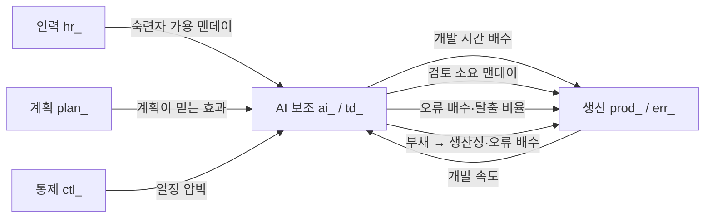

# AI 보조 개발 생산성 요인과 통합 프로젝트 모델 확장 설계

기준일 2026-10-29. 상태: **설계 초안(구현 전)**. 목적은 LLM 코딩 에이전트(Claude, Codex 등)로 개발하는 조직의 생산성을 SPD의 통합 프로젝트 모델([03](03.통합프로젝트모델명세.md))에 반영하는 방법을 정하는 것이다. 이 문서는 ① 관련 문헌에서 읽은 요인, ② 요인별 근거의 강도, ③ SPD 모델에 넣을 구조, ④ 조직 데이터로 보정하는 방법, ⑤ 구현 순서와 결정할 것을 정리한다.

## 0. 먼저 읽을 것: 이 설계의 신뢰 수준

- **요인의 방향**(무엇이 무엇을 늘리고 줄이는가)은 문헌 여럿이 같은 쪽을 가리킨다.
- **요인의 크기**(몇 배, 몇 %)는 문헌마다 크게 다르다(작업 시간 +19%에서 -55.8%까지, 아래 2장). **기본값으로 하나를 고르지 않는다.** 크기는 사용자 입력과 분포(위험 분석, RSK)로 다루고, 조직의 실측으로 보정(VAL-05)한다.
- 읽은 논문 중 **SPD에 그대로 넣을 수 있는 수치와 수식을 가진 것은 없다**(2장의 근거 표). 이 문서의 수식은 문헌의 구조를 SPD 변수에 옮긴 **제안**이다.
- 이 문서는 사용자 가정 "2023년 이전과 지금의 기능 점수당 생산성이 완전히 달라졌다"를 **검증하지 않는다**. 그 변화의 크기는 조직 데이터로 정할 값이고, 모델은 그 값을 받을 구조만 준비한다.

## 1. 읽은 문헌

| 약호 | 문헌 | 종류 | 읽은 범위 |
|---|---|---|---|
| **AND** | Anderson, Parker, Tan, *Generative AI and Software Quality Dynamics*, System Dynamics Society 2026 | 시스템 다이내믹스(Vensim) | 확장 초록 3쪽. **수식·파라미터 값은 없다** |
| **ACEM** | *ACEM: A Cost Estimation Model for Agentic Software Engineering*, arXiv 2608.02582 | 비용 추정 모델 제안 | 3장(모델) 전체, 3.8(가정), 5장(검증 계획) |
| **HIE** | *Hybrid Intelligence Effort*, Frontiers in AI 2026 (10.3389/frai.2026.1772418) | 개념 틀 | 웹 본문(일부 잘림) |
| **QUE** | Bartolucci, Vivo, *Queue & AI*, arXiv 2605.27202 | 대기행렬 이론 | 초록·서론·결과 2.1~2.2 |
| **SLR** | *Impact of LLM-Assistants on Software Developer Productivity: A Systematic Literature Review*, arXiv 2507.03156 | 체계적 고찰(37편, 2014~2024) | 웹 본문 앞 3분의 1 |
| **RCT** | Becker 등, METR, arXiv 2507.09089 | 무작위 대조 시험 | 초록 |
| **MED** | Medappa 등, arXiv 2510.10165 | 오픈소스 관찰 연구 | 초록 |
| **HE** | He 등, *Speed at the cost of quality (Cursor)*, arXiv 2511.04427 | 차이의 차이 분석 | 초록 |
| 그 밖에 | Peng 등 2023(Copilot 통제 실험), Cui 등 2024(현장 실험 3건), METR 2026-02 기록 분석 | 실증 | 검색 요약(원문 미확인) |

## 2. 문헌이 말하는 것

### 2.1 근거의 강도

| 근거 | 말하는 것 | 강도와 한계 |
|---|---|---|
| Peng 등 | Copilot으로 한 과제를 **55.8% 빨리** 끝냄(HTTP 서버 작성). 참가자는 효과를 35%로 **과소** 예측 | 통제 실험, **한 가지 쉬운 과제** |
| Cui 등 | 주당 PR 수 Microsoft **+12.9~21.8%**, Accenture **+7.5~8.7%** | 현장 실험 1,974명, 저자가 정밀도 낮다고 경고 |
| RCT | 숙련 오픈소스 개발자 16명, 246개 과제에서 AI 허용 시 완료 시간 **+19%(느려짐)**. 개발자는 사전에 -24%, 사후에 -20%로 **빨라졌다고 믿음** | 무작위 대조이나 **n=16, 익숙한 성숙 프로젝트**, 2025 초 도구 |
| MED | Copilot 도입 후 전체 생산성은 늘지만 **주변 개발자**가 이끌고, **핵심 개발자는 리뷰 +6.5%, 자기 원본 코드 생산성 -19%** | 관찰 연구(오픈소스) |
| HE | Cursor 도입 후 **속도는 일시적으로 크게 상승**하나 정적 분석 경고와 복잡도가 **지속적으로 상승**하고, 이것이 장기 속도 저하의 주된 원인 | 차이의 차이, 오픈소스. 효과 크기는 초록에 없음 |
| SLR | 효과가 과제 유형·경험·도구·조직 준비도에 따라 갈림. 처리량 +24%·품질 +26%(설문)이나 **처리량과 품질이 음의 상관(r=-0.45)**(70개 기업). 장기·팀 단위 연구 없음 | 37편 중 64%가 탐색적, 자기 보고 위주 |
| AND | 생산성 이득은 **역U자형**. 적정점이 있고 그 이상은 기술 부채 악순환으로 매출·품질이 무너짐. 짧은 프로젝트, 숙련자, 새 코드베이스에서 더 많은 AI가 최적 | 시뮬레이션, **초록만 읽음**. 수치 없음 |
| QUE | 평균 작업 시간이 줄어도 **검토를 빠져나간 오류가 재작업으로 돌아오면** 워크플로 전체는 느려질 수 있음(분산 쐐기). 혼잡하면 검토자가 오히려 **덜 꼼꼼히** 봄. AI가 과부하를 풀려면 AI 처리 비율이 임계값을 넘고 **검토 + 예상 재작업 시간 < 수작업 시간**이어야 함 | 이론, M/G/1 **단일 서버**, 보정 없음. 예시 값(수작업 1시간, 검토 0.5시간, 탈출 확률 0.15)은 설명용 |
| ACEM | 기능 점수·COCOMO·스토리 포인트는 **구현을 사람이 한다는 가정**이라 에이전트 개발에 안 맞음. 비용 = 토큰 비용 + **사람 검토·재작업(HITL)** + 인프라. 거절률 r, 재시도 n으로 `RF = 1 + r·n`, 위치에 따른 컨텍스트 증가 `CF = 1 + α·i/N` | **제안 모델, 검증 전**. 상수(β, γ, α)를 비워 둠, 저자가 식별 가능성(A7)·구성 분리(A8)를 열린 문제로 명시 |
| HIE | 노력 = LLM 인지 복잡도 + **사람 감독 노력**. 다섯 차원: 추론 복잡도, 컨텍스트 완전성, 코드 변경 파급, **반복 추론 횟수**, 사람 감독. 크기·기능 범위의 단조 함수가 아님 | 개념 틀, **교정 안 됨** |

### 2.2 문헌 사이의 긴장 (모델이 풀어야 할 것)

1. **속도가 빨라진다 vs 느려진다**: Peng(+)과 RCT(-)는 과제·숙련도·코드베이스 익숙함의 차이로 설명된다. 단일 배수가 아니라 **조건에 따른 배수**여야 한다.
2. **개인 속도 vs 조직 속도**: QUE·MED가 일치한다. 생성이 빨라지면 병목이 **검토**로 옮겨가고, 그 부담은 소수의 숙련자가 진다.
3. **단기 vs 장기**: AND·HE가 일치한다. 이득이 먼저 오고 비용(부채·복잡도)이 뒤늦게 온다. 프로젝트 기간이 모델의 결과를 가른다.
4. **인식 vs 실제**: Peng(과소 예측), RCT(방향 자체를 오인), QUE(자기 보고 과대)가 모두 말한다. **계획은 인식한 효과로 세우고 실행은 실제 효과로 일어난다.**

## 3. 요인 정리

| ID | 요인 | 정의 | 방향 | 주요 근거 | SPD에 이미 있는 것 |
|---|---|---|---|---|---|
| F1 | **AI 적용 비율** x | 개발 작업 중 AI가 초안을 만드는 비율(0~1) | 정책 변수 | QUE(라우팅 비율), AND | 없음 |
| F2 | **생성 가속** g | AI로 만든 작업이 순수 생성만 볼 때 몇 배 빠른가 | 개발 시간 ↓ | Peng, Cui | `pro_prod`, `new_prod` |
| F3 | **반복·재시도 오버헤드** | 프롬프트-응답-수정 반복과 거절된 출력의 재시도 | 개발 시간 ↑ | ACEM(RF), HIE(반복 사이클) | 없음 |
| F4 | **검토 노력** | AI 출력을 사람이 읽고 확인하는 시간 | 사람 시간 ↑ | QUE(r), ACEM(HITL), HIE | `qa_mp_per_error`(검출 단계만) |
| F5 | **검토 용량과 부하** | 검토할 수 있는 사람(주로 숙련자)의 용량 대비 검토할 양 | 부하 ↑ → 검토 깊이 ↓ | QUE, MED | `hr_pros`, `hr_avail_mp` |
| F6 | **오류 특성** | 생성 직후 오류 밀도, 검토를 빠져나가는 비율 | 탈출 오류 ↑ 또는 ↓ | QUE(p(r)), SLR(품질 혼재), HE | `err_per_task_*`, `err_pressure_mult`, `err_escape_rate` |
| F7 | **기술 부채 누적** | 복잡도·중복·구조 악화가 쌓이는 정도 | 생산성 ↓, 오류 ↑ | AND, HE | 없음 |
| F8 | **부채 상환(리팩터링)** | 개발 시간 중 부채를 갚는 데 쓰는 비율 | 부채 ↓, 개발 시간 ↓ | AND(20% 미만이 관행) | 없음 |
| F9 | **숙련도 구성** | 신입·숙련자 비율, 도구 사용 경험 | 효과와 부채 생성이 다름 | AND(신입이 부채 빠르게 생성), MED, RCT | `hr_new`, `hr_pros`, `err_mix_mult` |
| F10 | **코드베이스 조건** | 새 코드(greenfield)냐 기존 시스템(brownfield)이냐, 초기 부채 | 기존이면 효과 ↓, 부채 취약 ↑ | AND, RCT(익숙한 대형 프로젝트) | `total_tasks`(초기 부채는 없음) |
| F11 | **인식과 실제의 차이** | 계획·보고가 쓰는 효과와 실제 효과의 차이 | 일정 지연 | Peng, RCT, QUE | `plan_dev_prod`, `plan_known_fraction` |
| F12 | **과제 유형과 맥락** | 알고리즘·라이브러리 과제냐, 디버깅·통합이냐. 컨텍스트 완전성 | g와 재시도율을 바꿈 | SLR, HIE | 없음 |
| F13 | **사람 감독 강도(HIS)** | 검토 지점의 밀도: 마일스톤, 스토리, 과제, 모든 행동 | F4·F6을 정함 | ACEM(HIS-1~4) | 없음 |
| F14 | **AI 사용 비용** | 토큰·인프라 비용 | 맨데이가 아닌 금액 | ACEM | 없음(맨데이만 센다) |
| F15 | **프로젝트 기간** | 부채가 영향을 줄 만큼 긴가 | 길수록 부채 영향 ↑ | AND | `planned_duration_days` |
| F16 | **상호관계 복잡도(규모 의존)** | 규모가 커질수록 모듈·컴포넌트 사이 관계가 늘어 검증 대상이 늘어난다는 가설. 문헌은 정성 근거뿐이고 **초선형 증가를 직접 측정한 연구는 못 찾았다** | 규모 ↑ → 검출 효율 ↓ | Patchwork(계약 위반이 테스트를 통과), Frontiers(규모 가정이 깨짐), 사용자 제기 | `comm_coeff`(사람 수의 n²만, 모듈은 아님) |
| F17 | **검증 수단의 신뢰도** | 테스트가 스펙과 같은 AI에서 나오면 맹점을 공유한다(공통 원인 실패). 테스트 통과는 구현 정합성의 증거가 아니다 | 탈출 비율 하한 ↑ | Patchwork, BlindSpotEval(LLM 테스트의 경계값·예외 경로 맹점, 단언 오류 15.6%), 사용자 제기 | `err_escape_rate`, 4.2(c)의 `ai_miss_floor` |

### 3.1 문헌에서 얻지 못한 것

- F2·F6·F7의 **값**: 문헌마다 다르고(2.1), 조직·도구·시점에 따라 변한다(ACEM의 A4: 에이전트가 바뀌면 재보정).
- F7(부채)을 **무엇으로 재는가**: HE는 정적 분석 경고와 복잡도를 쓴다. SPD는 "부채 점수"를 태스크 단위로 둘 수밖에 없고 조직의 지표와 연결하는 방법은 보정 단계의 일이다.
- 기능 점수 당 생산성의 2023년 전후 **직접 비교 논문**은 찾지 못했다.

### 3.2 검토했으나 이번에는 넣지 않은 것 (결정 D8)

사용자가 제기한 "스펙(MD) 자체의 정합성, 상호관계 오류, 테스트 의존 검증"에 대해 추가 조사를 했다(3.3). 다음은 **요인 후보로만 기록하고 모델에 넣지 않는다.**

| 후보 | 내용 | 보류 이유 |
|---|---|---|
| G2 스펙 결함과 증폭 | 스펙·설계 오류가 구현 오류로 증폭됨. Abdel-Hamid 모델의 설계/코딩 오류 구분([03](03.통합프로젝트모델명세.md) 1.2에서 제외한 항목) | 조직 자료 없이는 보정할 수 없고, 식별 불가능(ACEM A7) 위험이 있다 |
| G4 상호관계 오류의 검출 난이도 | 단위 오류는 테스트가 잡고 계약 위반은 못 잡음 | G2와 같이 오류 종류 분리가 필요하다 |
| G5 코드 변경 파급 | 변경이 번지는 범위(HIE의 다섯 번째 차원). 처음 정리할 때 빠뜨렸다 | F16과 겹쳐 따로 두지 않고 F16의 규모 의존으로 흡수 |

**오류 종류 분리(구현·스펙·상호관계)는 실험으로 필요성을 확인한 뒤에 결정한다.** 7.2의 실험을 본다.

### 3.3 추가로 읽은 근거 (스펙·상호관계·테스트 의존 검증)

초록 수준으로만 확인했다.

| 근거 | 말하는 것 |
|---|---|
| Patchwork Problem (arXiv 2607.08981) | 변경이 지역적으로는 맞지만 저장소 전체와 어긋나는 실패(선언 안 한 설정 키 읽기, 존재하지 않는 패키지 import, 형제 경로의 인증 가드 누락). **대부분이 타입 검사·테스트·정적 보안 분석을 통과**. 모델 2종·프롬프트 4종·실패 분류 8개. 수치는 초록에 없음 |
| Beyond Coverage and Mutation (arXiv 2610.32548) | LLM이 쓴 단위 테스트는 null·음수·빈 입력의 비율이 34.8%·23.8%·38.8%로 낮고 예외 경로를 거의 안 보며, 테스트 실패의 15.6%는 단언 오류. 정상 경로 편향 |
| Specification-Driven Development as the Foundation (arXiv 2607.16680) | 구조화된 스펙을 기준 문서로 삼는 거버넌스 모델 제안. 초록의 수치(보안 결함 73%↓)는 표본·설계 정보가 없어 확인 불가 |
| EvoCodeBench, MultiFileTest | 다른 파일의 의존성 사용을 복사하다 인자가 어긋남, 멀티파일 테스트가 어려움(요약 수준) |

**빈 곳**: 규모에 따라 상호관계 오류가 초선형으로 늘어나는지를 AI 개발에서 측정한 통제 연구, 스펙 오류의 비율과 증폭 배수의 AI·SDD 맥락 실측은 **찾지 못했다.**

## 4. 모델 구조 제안

### 4.1 설계 원칙

1. **규모와 생산성을 분리한다.** `total_tasks`(요구사항·기능 규모)는 AI와 무관하게 그대로 둔다. AI는 **태스크당 사람 노력, 오류, 검토 부담**을 바꾼다. 이것이 ACEM의 논지(규모 지표는 복잡도의 대리이지 사람 노력의 척도가 아니다)와 맞고, 조직의 "기능 점수 당 생산성이 변했다"를 파라미터 변화로 표현할 수 있게 한다.
2. **AI는 단일 배수가 아니다.** 생성, 검토, 오류, 부채의 네 경로로 나눈다. 단일 배수 모델은 RCT와 Peng을 함께 설명하지 못한다.
3. **AI 적용 비율 x = 0이면 기존 모델과 비트 단위로 같다.** 3차의 검증 방식(불변식·재현성)을 그대로 쓸 수 있고, 기존 프로젝트와 기준선이 깨지지 않는다.
4. **새 되먹임을 추가한다.** 기존 4개 루프([03](03.통합프로젝트모델명세.md) 2장) 위에 5절의 AI 루프를 얹는다.
5. **값은 분포로 받는다.** 모든 AI 파라미터는 위험 분석의 분포 입력 대상이 된다.

### 4.2 새 섹터 `ai_` (5번째 섹터)



#### (a) 생성 가속과 반복 (F1, F2, F3, F9, F12)

```
ai_share         = ai_adoption                       // x. 정책 변수(0~1)
ai_gen_mix       = (hr_pros * ai_gen_pro + hr_new * ai_gen_new) / MAX(hr_total, 1)   // g. 숙련도별 가속
ai_dev_time_mult = (1 - ai_share) + ai_share * (1 / ai_gen_mix + ai_iter_overhead)   // 수작업 대비 개발 사람 시간
prod_productivity_ai = prod_productivity / ai_dev_time_mult
```

- 조화 평균 형태라 가속은 AI로 하는 부분에만 걸린다(암달의 법칙).
- `ai_gen_pro`가 1 이하일 수 있다(RCT: 익숙한 코드의 숙련자). 범위는 0.5 이상으로 열어 둔다.
- `ai_iter_overhead`는 ACEM의 `RF - 1 = r·n`과 HIE의 반복 사이클에 해당한다(수작업 시간 대비 비율).
- `prod_dev_rate`의 `prod_productivity`를 `prod_productivity_ai`로 바꾼다. **다른 식은 바꾸지 않는다.**

#### (b) 검토 용량과 부하 (F4, F5, F13) — 핵심 새 되먹임

```
ai_review_md_per_task = ai_review_md_nominal * ai_depth        // 태스크당 검토 맨데이
ai_review_demand      = prod_dev_rate * ai_share * ai_review_md_per_task   // 맨데이/일 (지각 지연 후 사용)
ai_review_capacity    = hr_pros * ai_review_cap_fraction      // 숙련자 시간 중 검토에 쓸 수 있는 몫
ai_load_ratio         = SMOOTH(ai_review_demand / MAX(ai_review_capacity, 0.01), ai_review_perception_delay)
ai_depth              = GRAPH(ai_load_ratio, [0, 0.8, 1, 1.5, 3], [1, 1, 0.8, 0.5, 0.25])   // 혼잡하면 얕게 본다 [QUE의 이론, 곡선은 가정]
prod_mp_review        = MIN(ai_review_demand, ai_review_capacity)   // 검토에 쓰이는 맨데이: 가용 맨데이에서 먼저 뺀다
```

- `prod_mp_review`는 기존 `prod_mp_qa` 앞에서 `hr_avail_mp`에서 빼서 `prod_mp_remaining`을 줄인다. 이것이 MED의 "핵심 개발자가 검토를 떠안아 자기 생산이 줄어든다"를 표현한다.
- `SMOOTH`(지각 지연)를 두어 `ai_review_demand`가 `prod_dev_rate`를 거쳐 자기 자신에 닿는 **대수 순환을 끊는다**(기존 `prod_rework_mp_perceived`와 같은 방식).
- `ai_depth`의 곡선은 QUE가 해석적으로 주는 "혼잡하면 임계 위험을 올린다"는 정성 결과를 옮긴 **가정**이다. 모양만 쓰고 값은 보정 대상이다.

#### (c) 오류 특성 (F6)

```
ai_review_miss = ai_miss_floor + (1 - ai_miss_floor) * EXP(-ai_verify_skill * ai_depth)   // QUE의 p(r) 형태. 검토가 없으면 1
ai_err_factor  = (1 - ai_share) + ai_share * ai_err_raw_mult * ai_review_miss
err_gen_rate   = prod_dev_rate * err_per_task_nominal * err_mix_mult * err_pressure_mult * ai_err_factor * td_err_mult
```

- `ai_err_raw_mult`: 검토 전 AI 출력의 오류 밀도 대 수작업(1이면 같음). SLR이 품질 혼재(개선과 악화가 모두 보고됨)이므로 **범위를 1 미만에서 시작해 열어 둔다**.
- 검토를 빠져나간 오류는 기존 `err_pde`로 들어가 **기존 QA 검출·탈출·재작업 흐름을 그대로 탄다.** 새 오류 레벨은 필요 없다.

#### (c2) 규모 의존 검출 효율과 후기 발견 비용 (F16, F17, P1b) — 구현 완료

오류 흐름을 쪼개지 않고 단일 흐름의 파라미터로 표현한다(결정 D8). **구현에서 바꾼 점**: 초안의 `GRAPH` 곡선(기울기 3개) 대신 **멱함수 하나(지수 1개)**로 했다. 파라미터가 적고 "규모가 2배일 때 검출 효율이 2^(−지수)배"로 읽혀 보정하기 쉽다.

```
ai_scale_detect_mult = MIN(1, (total_tasks / ai_scale_ref) ^ (-ai_scale_exponent))   // 기준 규모 이하는 1(영향 없음), 지수 0이면 항상 1
err_detect_rate      = MIN(err_potential_detect * ai_scale_detect_mult, err_pde / DT)
prod_test_mp_per_task = (test_plan_md_per_task + err_escaped_density * test_md_per_error * ai_late_rework_mult) / MAX(prod_loss_mult, 0.05)
```

- `ai_miss_floor`(검증이 AI 테스트에 기대면 높게 둠, F17)는 P1에서 이미 구현했다.
- `ai_late_rework_mult`는 시험에서 발견한 오류의 처리 노력 배수다(모델에서 시험 발견 오류는 재작업 흐름을 타지 않고 `test_md_per_error`로 처리된다).
- 두 파라미터는 **AI 사용과 무관하게 적용**된다(규모와 후기 발견은 AI 고유의 현상이 아니다). 기본값(지수 0, 배수 1)은 영향 없음이다.
- **알아 둘 점**: 이 모델은 시험에서 발견한 오류의 처리(0.15맨데이)가 QA 검출 + 재작업(0.3 + 0.5)보다 싸다고 둔다. 그래서 후기 배수 1에서는 QA가 덜 잡을수록 일정이 **오히려 줄어 보인다.** 늦게 발견할수록 비싸다는 현실은 이 배수를 1보다 크게 두어야 반영된다(구현 문서 [43](../03.구현/43.AI-보조-모델-규모-의존-검출과-후기-발견-비용.md)).

#### (d) 기술 부채 (F7, F8, F10, F15) — AND의 핵심 구조 (구현 완료, [44](../03.구현/44.AI-보조-모델-기술-부채.md))

> 구현에서 바꾼 점: 기존 시스템은 `td_initial` 대신 규모(`td_base_size`)와 초기 부채 비율(`td_initial_ratio`)로 받고, 곡선 민감도(`td_sensitivity`)를 더했으며, 리팩터링은 QA·재작업을 뺀 나머지에서 있는 부채만큼만 가져간다. 재현하지 못한 AND 결과(짧은 프로젝트, brownfield)는 구현 문서 44의 4장에 적었다.

```
Level td_level  초기값 td_initial                                    // 기존 시스템이면 > 0 (F10)
td_gen_rate     = prod_dev_rate * td_per_task * (1 + ai_share * (ai_td_mix - 1)) * (1 + td_compound * td_ratio)
                  // 새 코드가 부채를 낳고(AND), AI가 배수를 올리며(신입 > 숙련자), 부채가 부채를 낳는다
ai_td_mix       = (hr_pros * ai_td_pro + hr_new * ai_td_new) / MAX(hr_total, 1)
td_refactor_rate= prod_mp_refactor * td_refactor_prod            // 맨데이 → 부채 점 상환
td_obsolete_rate= td_level / td_obsolescence_time                // 서비스가 낡아 일부 부채가 무의미해짐(AND)
td_ratio        = td_level / MAX(prod_tasks_developed + td_base_size, 1)
td_prod_mult    = GRAPH(td_ratio, [0, 0.1, 0.25, 0.5, 1], [1, 0.97, 0.88, 0.7, 0.45])   // [가정] 단조 감소
td_err_mult     = GRAPH(td_ratio, [0, 0.25, 0.5, 1], [1, 1.1, 1.3, 1.8])                // [가정] 단조 증가
prod_mp_refactor= hr_avail_mp * refactor_fraction                 // 개발 맨데이에서 떼어 냄(F8)
```

- `td_prod_mult`를 `prod_productivity` 식에 곱한다. 이것이 AND의 "나쁜 코드가 생산성을 깎는" 균형 고리와, HE의 "경고·복잡도가 장기 속도를 늦춘다"를 표현한다.
- **x = 0이어도 `td_per_task > 0`이면 기존 모델과 달라진다.** 원칙 3을 지키려고 `td_per_task`의 기본값은 0으로 둔다(부채 섹터를 켜는 스위치). 즉 부채를 보려면 일부러 켠다.
- 곡선 값은 모두 **형태만 정한 가정**이다. AND 초록에 수치가 없다.

#### (e) 인식과 실제의 차이 (F11) — 구현 완료 ([45](../03.구현/45.AI-보조-모델-계획-오판.md))

> 구현에서 바꾼 점: 믿는 가속은 시간의 조화 평균 꼴(`1 + x·(1/g − 1)`)로 두어 중립이 비트 단위로 유지되고, `plan_dev_prod`를 쓰던 세 곳(초기 추정, 실적 대용값, 통제의 가정 생산성)에 적용한다. 인원을 고정하면 낙관적 계획이 일정을 앞당기는 대신 오류·소진을 늘리는 결과가 나온다(구현 문서 45의 4장).

```
plan_ai_gain      = (1 - ai_share) + ai_share * ai_gen_perceived          // 계획이 믿는 가속(수작업 대비 속도)
plan_dev_prod_eff = plan_dev_prod * plan_ai_gain                           // 초기 계획의 개발 생산성
```

- 초기 계획과 일정 재계획이 쓰는 `plan_dev_prod`에만 인식한 가속을 곱하고, 실행은 (a)~(d)의 실제 값을 쓴다. 차이가 곧 일정 지연이고, 기존 통제 섹터(`ctl_sched_pressure`)가 이를 감지해 압박→과로→오류의 기존 루프를 돌린다.
- RCT의 사례(개발자 인식 -24~-20%, 실제 +19%)를 `ai_gen_perceived > 실제 g`로 재현할 수 있다.

### 4.3 새 되먹임 고리

| ID | 구조 | 종류 | 근거 |
|---|---|---|---|
| **A1** 부채가 부채를 낳음 | 부채 ↑ → 부채 생성 배수 ↑ → 부채 ↑ | 강화 | AND |
| **A2** 나쁜 코드가 속도를 깎음 | 부채 ↑ → 생산성 ↓ → 개발 속도 ↓ → 새 부채 ↓ | 균형 | AND |
| **A3** 검토 혼잡의 악순환 | 개발 속도 ↑ → 검토 부하 ↑ → 검토 깊이 ↓ → 탈출 오류 ↑ → 재작업·시험 부하 ↑ → 가용 맨데이 ↓ → (지연) | 강화 | QUE, MED |
| **A4** 검토가 숙련자를 잠식 | 검토 부하 ↑ → 숙련자 검토 맨데이 ↑ → 개발 맨데이 ↓ → 개발 속도 ↓ → 검토 부하 ↓ | 균형 | MED |
| **A5** 상환 방어 | 부채 ↑ → (정책) 리팩터링 비율 ↑ → 부채 ↓, 개발 맨데이 ↓ | 균형 | AND(결과 5) |
| **A6** 계획 오판 | 인식한 가속 > 실제 → 지연 → 일정 압박 → (기존 루프 1) 오류 ↑ | 기존 루프 확장 | Peng, RCT |

A1+A2가 만드는 **역U자**(적정 적용 비율이 있음)와, A3가 만드는 **임계 혼잡**(검토 부하가 1을 넘으면 급격히 나빠짐)이 이 확장이 재현해야 할 두 가지 정성 행동이다.

## 5. 재현해야 할 행동과 검증

기존 모델의 방식(책의 수치 + 정성 + 불변식)을 따르되, 이번 확장은 **정량 정답이 없다.** 아래 시험은 모두 정성·불변식이다.

| 종류 | 기대 | 근거 |
|---|---|---|
| 불변식 | `ai_adoption = 0`, `td_per_task = 0`이면 기존 모델과 **모든 변수가 비트 동일** | 원칙 3 |
| 불변식 | `g = 1`, `iter = 0`, `review = 0`, `err_raw = 1`이면 x에 상관없이 기존과 동일 | 구조 점검 |
| 불변식 | 오류 보존식이 계속 성립 | 3차 S-불변식 |
| 정성 | x를 0에서 1로 올릴 때 **완료일이 먼저 줄다가 다시 늘어나는** 역U자(부채·검토를 켠 경우) | AND |
| 정성 | 검토 용량을 줄이면 `ai_load_ratio`가 1을 넘는 순간부터 탈출 오류와 재작업이 **급증** | QUE |
| 정성 | 짧은 프로젝트에서는 x가 높을수록 좋고, 긴 프로젝트에서는 최적 x가 낮아짐 | AND(결과 2) |
| 정성 | 신입 비율이 높으면 최적 x가 낮아짐 | AND(결과 3) |
| 정성 | `td_initial > 0`(기존 시스템)이면 최적 x가 낮아짐 | AND(결과 4) |
| 정성 | 검토 부하가 숙련자의 자기 개발 맨데이를 줄임 | MED |
| 정성 | `ai_gen_perceived`가 실제 g보다 크면 일정이 계획보다 늦어짐 | RCT |

극단 조건 시험(VAL-03)과 교란 시험(VAL-06)도 새 파라미터 범위에 대해 그대로 돌린다.

## 6. 조직 데이터로 보정하기

### 6.1 무엇을 모아야 하나

"기능 점수 당 생산성"의 전후 비교만으로는 위 파라미터를 **식별할 수 없다**(ACEM의 A7: 여러 조합이 같은 총량을 설명). 다음을 구분해 기록해야 한다.

| 자료 | 정하는 파라미터 |
|---|---|
| 같은 규모 과제의 AI 사용·비사용 개발 시간(숙련도별) | `ai_gen_pro`, `ai_gen_new`, `ai_iter_overhead` |
| 과제당 검토 시간, 검토자 | `ai_review_md_nominal`, `ai_review_cap_fraction` |
| 거절률·재시도 횟수, 병합 후 발견된 결함·재작업 | `ai_err_raw_mult`, `ai_verify_skill`, `ai_miss_floor` |
| 정적 분석 경고·복잡도 추세, 리팩터링 비율 | `td_per_task`, `ai_td_*`, `td_compound`, `refactor_fraction` |
| 계획 시점에 가정한 가속과 실제의 차이 | `ai_gen_perceived` |

### 6.2 SPD 기능으로 하는 법

- **VAL-01·02·05**(데이터 가져오기·오차 지표·보정): 위 자료를 CSV로 가져와 목적함수 `J = Σ w·NRMSE²`로 보정한다. 파라미터 수가 많으므로 **한 번에 하나의 묶음(생성 → 검토 → 부채)씩** 보정한다.
- **RSK**(위험 분석): 보정하지 못한 파라미터는 문헌 범위의 분포를 입력해 결과의 **범위**로 읽는다. 한 점 추정을 약속하지 않는다.
- **검증 기록(VAL-07)**: 어떤 파라미터가 조직 자료로 보정됐고 어떤 것이 문헌 범위인지 남긴다. 사용자 모델 안내(8.3)의 "보정·검증되지 않았을 수 있음"을 끄는 기준이 된다.

## 7. 구현 순서 제안

각 단계는 독립이고, **앞 단계만 해도 쓸 수 있다.**

| 단계 | 내용 | 새 Level | 효과 |
|---|---|---|---|
| **P0** | (a) 생성 가속·반복 + 숙련도 구분 + 적용 비율 + 파라미터 화면·예제 | 없음 | 조직의 "AI 후 생산성 변화"를 표현. 가장 작은 변경 |
| **P1** | (b)(c) 검토 용량·깊이·오류 탈출 | 없음(SMOOTH만) | 병목이 검토로 옮겨가는 것, MED·QUE 재현 |
| **P1b** | (c2) 규모 의존 검출 효율·탈출 하한·후기 발견 배수 | 없음 | 큰 프로젝트의 상호관계 복잡도와 테스트 의존 검증(F16, F17)을 단일 오류 흐름의 파라미터로 표현 |
| **P2** | (d) 기술 부채 Level·리팩터링 | 1(`td_level`) | 역U자, 단기/장기, 기존 시스템 |
| **P3** | (e) 인식과 실제 차이 + 계획 섹터 연결 | 없음 | 일정 지연의 원인 설명 |
| **P4** (구현 완료, [구현 47](../03.구현/47.AI-보조-모델-비용-층.md)) | ACEM의 **비용 층**(토큰·HITL·인프라 금액) | 없음(출력만) | 맨데이가 아닌 금액 KPI. 동역학에는 영향 없음 |

P0 직후 3차 기능(위험 분석, 검증)을 새 파라미터로 돌려 볼 수 있다.

### 7.1 어디에 만들 것인가 (결정 D1)

- **안 A**: 통합 프로젝트 모델에 `ai_`·`td_` 파라미터를 추가하고 기본값은 모두 "영향 없음"으로 둔다. 모델 버전이 올라가므로 **기존 프로젝트의 채택 기준선이 "모델 버전 불일치" 경고를 낸다.**
- **안 B(추천)**: **새 내장 모델 `integrated-project-ai`**를 만들고 기존 모델은 그대로 둔다. 기존 프로젝트·검증 기록·기준선이 영향을 받지 않고, 두 모델의 차이를 시나리오 비교로 본다. 코드 중복은 모델 편집기의 사본 기능으로 시작해 내장 모델로 굳히면 줄일 수 있다.

### 7.2 오류 종류 분리가 필요한지 확인하는 실험 (D8)

P0·P1·P1b를 구현한 뒤 한다. 시뮬레이션 실험이며 **현실을 증명하지 않는다**(모델 안의 민감도 시험).

1. 단일 오류 흐름 모델(P1b까지)과, **오류 흐름을 구현·스펙으로 나눈 변형**(모델 편집기 사본)을 만든다.
2. 같은 정책 후보를 두 모델에 돌린다: AI 적용 비율, 스펙 검토 투자, 테스트 증원, 리팩터링 비율 등. 시나리오 비교와 위험 분석(분포 입력)을 쓴다.
3. **정책 순위가 바뀌는 파라미터 범위**를 본다.
4. 분리를 정식 모델로 올리는 기준: ① 문헌 범위 안의 **현실적인 영역에서** 순위가 바뀌고, ② 조직이 오류를 종류별로 기록한 자료를 낼 수 있을 때. 어디서도 안 바뀌면 분리하지 않는다.

> **2026-10-30 실험 결과**([구현 46](../03.구현/46.AI-보조-모델-오류-종류-분리-실험.md)): 순위는 **스펙 오류 몫 ≥ 0.4이면서 스펙 오류의 후기 발견 배수 ≈ 8 이상**인 좁은 영역에서만 실질적으로 바뀐다(분리하지 않으면 스펙 검토의 일정 단축 효과를 약 6%p 낮게 보고 1위를 놓친다). 그 밖에서는 근소한 차이다. **D8 유지(지금은 분리하지 않음).** 조직 결함 기록에서 스펙 결함 비율과 스펙·구현 결함 수정 노력비를 낼 수 있으면 다시 판단한다.

## 8. 결정이 필요한 것

> **2026-10-29 확정**: D1~D8을 아래 제안대로 정했다(사용자 승인).


| ID | 결정 | 제안 |
|---|---|---|
| D1 | 구현 위치(7.1) | 안 B, 새 모델 |
| D2 | 기본값을 문헌의 대표값으로 채울지, 0(영향 없음)으로 둘지 | **0으로 두고 문헌 범위를 도움말·분포 예시로 제공.** 대표값을 고르면 근거 없는 결론이 된다 |
| D3 | 숙련도 구분: 신입·숙련자 2레벨(기존 인력 구조)을 그대로 쓸지 | 그대로 쓴다. 문헌의 core/peripheral과 대응 |
| D4 | 검토 용량을 숙련자 인원의 비율로 둘지, 별도 인력 풀(리뷰어)을 둘지 | 숙련자 비율. 별도 풀은 인력 섹터 변경이 큼 |
| D5 | 부채를 "태스크 환산 점수"로 둘지 | 그렇게 두되 조직 지표와의 연결은 보정 단계의 몫 |
| D6 | 비용 층(P4)을 이번 범위에 넣을지 | 후순위. 먼저 맨데이·일정 동역학 → **2026-10-30 구현**(출력 전용, 단가는 모두 입력·기본 0) |
| D7 | 병렬 에이전트(여러 에이전트 동시 작업)를 모델링할지 | 이번에는 제외. ACEM도 A1에서 제외, 병렬은 `hr_` 인원 개념과 맞지 않음 |
| D8 | 오류 종류 분리(구현·스펙·상호관계)를 모델에 넣을지 | **지금은 넣지 않는다.** F16·F17을 단일 흐름의 파라미터로 표현하고(P1b), 7.2의 실험 뒤에 결정 |

## 9. 한계

- **크기를 모른다.** 구조(방향)는 근거가 있지만 곡선과 계수는 이 문서가 **가정으로 둔 형태**이다. 결과는 보정 전에는 "범위와 행동의 모양"으로만 읽어야 한다.
- AND는 확장 초록만 읽었다. 논문 전체가 공개되면 부채 구조(특히 노후화·부채 생성의 자기 의존)를 다시 맞춰야 한다.
- QUE는 단일 서버 대기행렬이고, SPD는 연속 시간 SD이다. **유량 근사**로 옮겼기 때문에 변동성(분산 쐐기)의 효과는 평균값으로 가려진다. 분산 효과를 보려면 위험 분석(Monte Carlo)으로 불확실성을 따로 넣어야 한다.
- ACEM·HIE는 **검증되지 않았다.** 이 문서가 가져온 것은 구조(RF·HITL·HIS)이고 그 수치가 아니다.
- 에이전트·모델이 빠르게 바뀐다. 보정값은 **도구와 시점에 묶인다**(ACEM의 A4). 보정 기록에 도구·모델 버전을 남기는 필드가 필요하다.
- 팀 단위·장기 실증이 부족하다(SLR). 장기 효과(A1~A2)는 현재로서는 시뮬레이션과 관찰 연구에만 근거한다.
